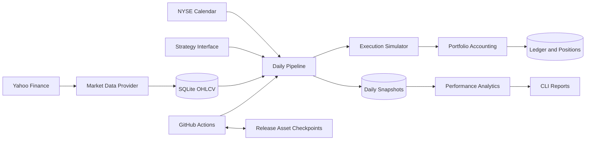

# Quant Trading System

[](https://github.com/Serenechien0172/quant-trading-system/actions/workflows/tests.yml)
[](https://github.com/Serenechien0172/quant-trading-system/actions/workflows/daily_pipeline.yml)

A Python 3.11+ paper-trading system built around one question: **how much did the
account make or lose this trading session?** Each account starts with **$100,000 USD**.
SQLite keeps an auditable trade ledger, positions, and immutable daily snapshots.
The project has no real-money broker connection.

## Features

- Daily SPY, QQQ, AAPL, NVDA, and MSFT OHLCV from yfinance.
- Incremental downloads, internal gap detection, validation, and unique symbol/date keys.
- Decimal accounting; long-only positions, fee-inclusive average cost, no borrowing.
- Cash, market value, equity, realized/unrealized P&L, and dividend income.
- Daily P&L, daily/cumulative returns, SPY total-return comparison, and performance metrics.
- Idempotent session processing, atomic account changes, and deterministic offline tests.
- US exchange calendar with holidays, early closes, and daylight saving time.
- GitHub Actions tests and daily execution with persistent account state.

## Architecture



The market data provider and strategy are replaceable interfaces. Execution applies
configurable fees; accounting enforces cash and ownership constraints. The daily
orchestrator commits corporate actions, orders, and a snapshot together. Failed
sessions roll back; already completed sessions are skipped on retries.

## Installation

```bash
git clone https://github.com/Serenechien0172/quant-trading-system.git
cd quant-trading-system
python3.11 -m venv .venv
source .venv/bin/activate
python -m pip install -r requirements.txt
python -m pytest -q
ruff check .
```

Windows activation: `.venv\Scripts\activate`. The default database is
`data/paper.db`; it is created automatically and excluded from Git.

## Usage

Start the default cash-only account at the latest completed US session:

```bash
python -m src.main update
python -m src.main pipeline
python -m src.main portfolio
python -m src.main trades
python -m src.main performance
python -m src.main history
```

`update` downloads prices only. `pipeline` processes unrecorded trading sessions,
simulates orders, and stores snapshots. Run both, in that order, each trading day.
Missing prices fail the pipeline; stale prices are never silently substituted.
Reports label the stored session date, rather than presenting old data as today.

To test actual account movements, use a **separate** database:

```bash
export PAPER_DB=data/dummy.db
python -m src.main update
python -m src.main pipeline --strategy dummy
python -m src.main portfolio
```

The clearly labeled dummy strategy buys **one SPY share once**, then holds it.
It is an accounting test, not an investment strategy. Strategy identity and start
date are immutable per account. Omit `--strategy` on later runs to reuse the
stored strategy. The cash strategy makes no trades and normally earns 0%.

For an explicit historical inception (a simple replay, not a research backtester):

```bash
export PAPER_DB=data/replay.db
python -m src.main update --start 2026-01-02
python -m src.main pipeline --start 2026-01-02 --strategy dummy
```

Start must be an exchange session, no later than the latest completed session.
The first snapshot is at the inception close. All intermediate sessions are
processed chronologically when execution catches up after downtime.

Configuration uses environment variables:

| Variable | Default | Meaning |
| --- | --- | --- |
| `PAPER_DB` | `data/paper.db` | Independent SQLite account |
| `PAPER_FIXED_FEE` | `1` | USD charged per executed order |
| `PAPER_FEE_BPS` | `0` | Basis points of traded notional |

Fees must be finite and nonnegative. Changes affect future orders only. Each
ledger record stores the actual fee. No API key is required for yfinance.

## Interactive Dashboard and Historical Demo

```bash
source .venv/bin/activate
python -m pip install -r requirements.txt
streamlit run dashboard/app.py
```

Open the URL printed by Streamlit (normally http://localhost:8501), or the deployed
Community Cloud app. Select **Run Demo Simulation** on the main page labeled
**Historical Simulation — Paper Money Only**. No pre-existing account or database
is needed. The default dates are 2025-01-01 through the latest completed US session.
It includes starting capital, ending portfolio value, trade count, portfolio
metrics, an explicit outperformance/underperformance comparison in percentage points,
interactive equity and benchmark charts, positions, recent trades, and daily P&L
history. Charts support zoom, hover, and date-window selection. Trade and history
tables can be downloaded as CSV. Headline metrics always cover the entire account
history; the chart-period selector only restricts the displayed dates and does not
rebase returns. SPY is the existing total-return benchmark, including dividends.

The public demo trades SPY, QQQ, AAPL, NVDA, and MSFT in one $100,000 account.
Each bullish entry has a budget capped at 20% of the previous session's equity,
including fees, and available cash. Existing positions are held until their own
bearish signal; this is not daily equal-weight rebalancing. Sells execute before
buys. Unused allocations remain cash; no borrowing or short selling is allowed.

The simulation runs in a unique temporary directory, loads its report into
`st.session_state`, and deletes the temporary database before returning. Separate
browser sessions never discover each other's simulations. Results last for the
session and may disappear on refresh, disconnect, or app restart; rerun the demo
to recreate them. Failed reruns preserve the session's previous successful result.
The app needs Yahoo Finance network access but no credentials or uploaded files.
Rate limits, empty data, and internal gaps show a useful error instead of a traceback.
If the newest session is not available for all symbols, the demo uses the latest
common session within five trading sessions of the requested end and labels it.
It does not invent or forward-fill missing bars.

Use the account selector to inspect a live paper account only where one is configured.
An absent live database does not prevent the historical demo. The dashboard opens
live account databases read-only; it never submits live paper trades.
The latest session date is explicit, and stale live snapshots are flagged. Historical
P&L is labeled "Latest session P&L", never presented as today's trading result.

The existing local CLI demo remains available separately:
`python -m src.main demo --start 2025-01-01 --end 2026-10-01`.
This single-symbol demo uses a simple **20/50 SMA strategy** on SPY by default. Optional
`--symbol QQQ` (or AAPL, NVDA, MSFT) changes the traded symbol while retaining SPY
as the benchmark. It uses the existing `PAPER_FIXED_FEE` and `PAPER_FEE_BPS` settings.

- Buy when the previous session's 20-day SMA exceeds its 50-day SMA and the account
  is flat. Sell the entire position when the previous session's 20-day SMA falls below
  its 50-day SMA. Equal averages leave the position unchanged.
- Download 160 calendar days of warm-up; require at least 50 prior sessions. Warm-up
  data never creates portfolio returns or trades before the requested start.
- Inception is the first trading session's close, matching the SPY benchmark baseline.
  There is no inception-day trade. The first possible fill is the next session's open.
- Compute signals exclusively from dates before execution. Use only already-known
  splits to put the moving-average history on a consistent share basis. No execution-day
  close or later price enters the signal.
- Fill at the next open with whole-share sizing calculated from that opening quote,
  available cash, and fees. This is an idealized open-price execution model, without
  slippage or a guarantee of achieving an opening-auction fill in practice.
- Reuse the engine's corporate actions, execution simulator, fee-inclusive accounting,
  daily snapshots, and performance metrics. No borrowing or short positions.

Each CLI configuration writes a separate database under `data/demos/`, with the requested
dates, symbol, fees, and model version recorded in metadata. A repeat run builds a
fresh temporary database and replaces only the matching demo after success. Failed
runs leave prior results intact. Neither the default `data/paper.db` nor the configured
`PAPER_DB` can be used as a demo destination. The live `update` and `pipeline` commands
reject demo databases. No demo data is committed or uploaded to GitHub.

Yahoo can revise historical observations; these are retrospective experiments, not
an archival point-in-time feed. The downloader reverses Yahoo split adjustments
through the latest completed session before retaining only the requested demo window.
Those later actions restore nominal historical prices; they are not exposed to the
strategy. Tests also change future observations and verify that earlier trades and
snapshots remain identical.

Dashboard code lives in `dashboard/app.py`, `dashboard/data.py`, and
`dashboard/session_demo.py`; historical
simulation lives in `src/demo.py`. The only engine extension is an injectable strategy
and an optional open-price fill, with the existing live close-price default preserved.
Run the complete deterministic suite with `python -m pytest -q`.

## Virtual Portfolio and P&L

Money and share quantities are represented with `Decimal` and persisted as decimal
strings. Display rounds USD to cents; internal calculations retain precision.
Fractional shares are supported, including shares created by splits.

```text
Buy debit        = quantity * execution price + transaction cost
Average cost     = remaining fee-inclusive cost basis / shares owned
Sell proceeds    = quantity * execution price - transaction cost
Realized P&L     = sell proceeds - allocated average cost basis
Position value   = shares owned * current session closing price
Unrealized P&L   = position value - remaining cost basis
Portfolio equity = cash + all position values
Daily P&L        = current equity - previous session equity
Daily return     = daily P&L / previous session equity
Total return     = current equity / 100000 - 1
```

The first daily P&L compares equity to $100,000, so initial fees appear immediately.
Example: buy 10 shares at $100 with a $1 fee. Cash becomes $98,999; basis becomes
$1,001. At a $110 close, equity is $100,099 and unrealized P&L is $99. Selling all
10 at $110 with another $1 fee leaves $100,098 cash and $98 realized profit.

At every snapshot, within decimal arithmetic precision:
`equity - initial capital = realized P&L + unrealized P&L + dividend income`.
There are no deposits, withdrawals, interest, taxes, or external cash flows.

Splits change share quantity and leave cost basis unchanged. Dividends are credited
on the ex-dividend date, a deliberate simplification of payable-date cash accounting.
Corporate actions are recorded separately from simulated trades. Yahoo's historical
split adjustments are reversed within each fetched window to preserve nominal
execution prices; cached bars are not retroactively rewritten.

The benchmark buys fractional SPY units at the account's inception close, applies
splits, and reinvests dividends at each ex-date close, with no benchmark fees.
`Alpha vs SPY` is the difference in cumulative returns, **not regression alpha**.
All daily snapshots remain queryable in SQLite's `snapshots` table.

## Performance Metrics

| Metric | Definition |
| --- | --- |
| Total return | Latest equity / initial equity - 1 |
| Annualized return | `(1 + total return) ** (252 / elapsed sessions) - 1` |
| Annualized volatility | Sample standard deviation of stored daily returns * sqrt(252) |
| Sharpe ratio | Mean stored daily return * 252 / annualized volatility; risk-free rate = 0 |
| Maximum drawdown | Worst equity decline from its running peak, including initial capital |
| Win rate | Profitable SELL executions / all SELL executions, after allocated fees |

Annualization uses the number of sessions **after** the inception close. Volatility
and Sharpe include the inception fee return. Partial sales count as individual
SELL executions; break-even sells are not wins. Undefined metrics are `N/A`,
including Sharpe with zero volatility and win rate without sells. Metrics from a
very short history are mechanically computed and should not imply predictive value.

## Automated Daily Pipeline

`.github/workflows/daily_pipeline.yml` runs at **22:37 UTC Monday-Friday**,
which is 18:37 US Eastern during daylight time and 17:37 during standard time.
In Taipei this is 06:37 the following day. The NYSE calendar gates processing:
holidays and duplicate runs do not create extra trades or snapshots. Jobs may
still start on weekday exchange holidays and simply find no new session.

The workflow uses Python 3.11, installs dependencies, runs lint/tests, restores the
account, downloads data, executes the paper pipeline, prints reports in the Actions
job summary, and persists state. Nonzero exits fail the job and emit an error annotation.
GitHub schedules are best-effort and can be delayed; manual `workflow_dispatch`
supports catch-up. Scheduled workflows run from the default branch.

**First cloud run:** after publishing, open Actions > Daily Pipeline > Run workflow.
Select `initialize=true` and either `cash` or `dummy`. This creates a separate cloud
account. Future schedules restore it and reuse its saved strategy. Leave initialize
false thereafter. A missing or unreadable existing state never silently resets cash.

State is stored as `paper.db` on the `paper-state` GitHub release, **not in Git**.
The prior database is saved as `paper-previous.db` before replacement. Release
assets persist until deleted; diagnostic workflow artifacts expire after 30 days.
Serialized workflow concurrency prevents simultaneous writers. The workflow's
built-in `GITHUB_TOKEN` requires repository `contents: write` permission. No personal
token is stored in source. Future external credentials belong in GitHub Secrets.

Release asset replacement is not transactional. If uploading the current database
fails, use the previous release asset or the failed run's diagnostic artifact to
restore `paper.db`, then rerun. Do not initialize a fresh account for recovery.
Deleting the state release deletes cloud account history unless backups survive.
Repository visibility also determines who can download its paper-account release assets.

Local and cloud databases are independent. The workflow never uploads a local
database automatically. Yahoo can rate-limit or revise data; a missing bar aborts
ingestion. This milestone does not automatically restate snapshots after provider
corrections, nor model delistings, mergers, spin-offs, spread, slippage, or liquidity.
Orders fill at the stored close. Future signal strategies must use prior-session
information or an explicit next-session execution model to avoid look-ahead bias.

## Project Structure

```text
quant-trading-system/
  .github/workflows/
    tests.yml
    daily_pipeline.yml
  src/
    __init__.py
    config.py          # Capital, symbols, fees, paths
    storage.py         # Schema and atomic transactions
    calendar.py        # Exchange sessions and close times
    market_data.py     # Yahoo provider and incremental ingestion
    portfolio.py       # Cash, cost basis, positions, corporate actions
    execution.py       # Paper execution and fees
    strategies.py      # Strategy interface, cash, dummy
    pipeline.py        # Daily orchestration and snapshots
    analytics.py       # Returns and performance metrics
    main.py            # CLI commands and reports
    cloud_state.py     # Durable Actions checkpoints
  tests/               # Deterministic accounting, data, CLI, recovery tests
  requirements.txt
  pyproject.toml
  .gitignore
  README.md
```

`data/`, `.venv/`, caches, reports, and environment files are ignored. Tests use
temporary databases and fake data; they do not contact Yahoo or GitHub.

## Roadmap

1. Strategy-specific accounts and configurable signal generation.
2. Event-driven backtesting with next-session fills and point-in-time data.
3. Position sizing, exposure limits, drawdown controls, and risk monitoring.
4. Paper-broker adapters and reconciliation, keeping real-money execution disabled.
5. Dashboard with equity curve, daily P&L calendar, benchmark, and trade drill-down.
6. External durable database, schema migrations, alerts, and data revision audits.

## References

- [yfinance price history](https://ranaroussi.github.io/yfinance/reference/yfinance.price_history.html)
- [NYSE calendars](https://pandas-market-calendars.readthedocs.io/en/latest/)
- [GitHub scheduled workflows](https://docs.github.com/en/actions/reference/workflows-and-actions/events-that-trigger-workflows#schedule)
- [GitHub artifact retention](https://docs.github.com/en/actions/tutorials/store-and-share-data)

This is a paper-account engineering project. Dummy strategy results are test output.
